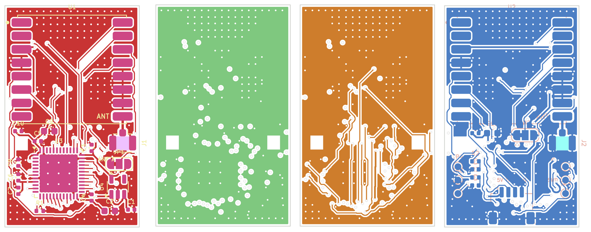

# Dual SX1280 초소형 보드 (NiceRF LoRa1280 ×2 + STM32F103)

NiceRF **LoRa1280 시리즈 데모보드**(SX1280 ranging demo board)의 구성(LoRa1280 모듈 + 48핀 STM32 계열 MCU + 3~12 V 입력)을
기준으로, **SX1280 모듈 두 개를 동시에 쓰는 20 × 33 mm 4층 양면 보드**로 다시 설계한 것입니다.

## 사양
| 항목 | 내용 |
|---|---|
| 크기 | 20.0 × 33.0 mm, 4층, 1.0 mm 두께 권장 |
| 무선 | NiceRF LoRa1280 ×2 (SX1280, 2.4 GHz LoRa/FLRC/GFSK/레인징, 최대 12.5 dBm) |
| 배치 | 무선 A(U1) 윗면, 무선 B(U2) 아랫면, 같은 위치에 겹쳐 실장 |
| 안테나 | 무선마다 U.FL 1개 (J1 윗면, J2 아랫면), 50 Ω CPWG 약 2.4 mm |
| MCU | STM32F103CBU6 (UFQFPN48, 128 KB), 크리스털 없음(HSI) |
| 무선 연결 | A = SPI1, B = SPI2, 각각 NSS/BUSY/DIO1/NRESET 독립 → 두 무선 동시 동작 |
| 호스트 | J3 JST-SH 1.0 mm 4핀: 1 = +5 V, 2 = TX(PA9), 3 = RX(PA10), 4 = GND |
| 전원 | 5 V 입력 → AP2112K-3.3 (600 mA) |
| 펌웨어 기록 | 아랫면 SWD 패드(SWDIO/SWCLK/NRST/3V3/GND) 또는 BOOT0 패드 + USART1 ROM 부트로더 |
| 표시 | LED 2개(아랫면): PA12 녹색(무선 A), PA15 파랑(무선 B). PA15는 JTDI 겸용이라 펌웨어에서 JTAG을 끄고 SWD만 켜야 합니다(SWJ_CFG=010) |

핀 정의는 [firmware/board_pins.h](firmware/board_pins.h)에 있습니다.

### LoRa1280 핀 (16핀, 2.0 mm 피치 캐스텔레이션, 16 × 16 mm)
`1 DIO2 · 2 DIO3 · 3 VCC · 4 GND · 5 MISO · 6 MOSI · 7 SCK · 8 NSS · 9 ANT · 10–12 GND · 13 NRESET · 14 GND(TCXO판은 TCXOEN) · 15 BUSY · 16 DIO1`

### JP1 / JP2 (모듈 14번 핀)
- 기본값은 1-2 브리지(GND)이며, 일반 **LoRa1280 / LoRa1281** 모듈에 맞습니다.
- **LoRa1280-T(TCXO)** 모듈을 쓸 때만 1-2 사이를 칼로 끊고 2-3을 납땜합니다. 그러면 3V3이 들어가 TCXO가 켜집니다.
- 일반 모듈에서 2-3을 연결하면 3V3이 GND에 단락됩니다.

## 디렉터리
| 경로 | 내용 |
|---|---|
| `scripts/design.py` | **설계 원본**: 부품, 좌표, 넷. 여기만 고치고 나머지는 재생성 |
| `scripts/gen_lib.py`, `gen_sch.py`, `gen_pcb.py` | 라이브러리 / 회로도 / PCB(배치·존·RF) 생성 |
| `scripts/route.py` | 자체 A* 자동배선기 (F.Cu / In2.Cu / B.Cu) |
| `scripts/check_netlist.py`, `drc.py` | 회로도·PCB 넷 대조, KiCad DRC |
| `scripts/export_fab.py` | 거버, 드릴, JLCPCB BOM/CPL, 미리보기 이미지 |
| `kicad/` | KiCad 7 프로젝트 (`dual_sx1280.kicad_pro/.kicad_sch/.kicad_pcb`) |
| `fab/` | 제조 파일 |
| `docs/` | 회로도 PDF/PNG, 레이어 이미지, DRC 리포트 |

## 확인이 필요한 가정
1. **데모보드 MCU 품번은 확인하지 못했습니다.** 공개 사진에서는 48핀 QFP라는 것만 보입니다. 그래서 STM32F103 계열로 가정했습니다.
   - 같은 48핀 STM32F103C8T6/CBT6(LQFP)와 핀 번호가 같습니다. 풋프린트만 바꾸면 그대로 쓸 수 있습니다.
   - 정확한 MCU는 NiceRF 데모 코드(`Lora1280 lora1281 Demo code.rar`)나 판매처에 문의해 확인하세요.
2. **LoRa1280 핀맵과 외형**은 NiceRF LoRa128X 데이터시트 Rev 2.2의 핀 표와 TinyGS의 NiceRF-1280 보드를 교차 확인한 것입니다.
   - 발주 전에 실제 모듈 데이터시트의 기구 도면과 패드 치수를 꼭 대조하세요.
3. **모듈 아래에도 트랙과 텐트 비아가 지나갑니다.** 모두 솔더마스크로 덮여 있습니다.
   - 모듈 밑면에 캐스텔레이션 외의 노출 구리가 있다면 그 부분을 비워야 합니다.
4. LCSC 품번은 일부만 넣었습니다. 비어 있는 품번과 재고는 직접 확인해야 합니다. MCU, LED, 모듈이 해당합니다.
5. LoRa1280 모듈은 JLC 부품이 아니어서 수납땜해야 합니다. BOM과 CPL에서도 빠져 있습니다.

## 검증 결과 (2026-11-12)
| 검사 | 결과 |
|---|---|
| 회로도 넷리스트와 `design.py` 대조 (`check_netlist.py sch`) | PASS, 넷 31개 |
| PCB 넷과 `design.py` 대조 (`check_netlist.py pcb`) | PASS |
| KiCad DRC (`drc.py`, 보고서 `docs/drc_report.txt`) | 오류 0, 미연결 0, 경고 4 |
| 코트야드 겹침 (앞·뒷면 각각) | 0 |

- 경고 4건은 모두 `starved_thermal`입니다. 서멀 스포크가 1개만 붙은 GND 패드라는 뜻이고, 연결 자체는 되어 있습니다.
- 배선 통계는 트랙 약 620 mm, 비아 219개입니다. 비아 중 112개는 GND 스티칭 비아입니다.
- 회로도 ERC는 KiCad 7 CLI로 돌릴 수 없어서 하지 않았습니다. 대신 넷리스트를 1:1로 대조하고, 출력 핀 중복 같은 핀 타입 검사를 했습니다.
- 배선은 자동배선기 결과입니다. 발주 전에 KiCad에서 한 번 열어 육안으로 검토하길 권합니다. 특히 RF 주변, 전원 트랙 폭, 실크 위치를 보세요.

## 제조 (JLCPCB 기준)
- 4층, 1.0 mm, 외층 1 oz 기준입니다. 50 Ω 계산 근거는 L1-L2 프리프레그 7628 약 0.21 mm입니다.
- 최소 트랙과 간격은 0.15 / 0.15 mm, 비아는 0.45 / 0.25 mm입니다.
- `fab/dual_sx1280_gerbers.zip`, `fab/bom_jlcpcb.csv`, `fab/cpl_jlcpcb.csv`를 사용합니다.
- SMT 실장은 양면입니다. 윗면에는 MCU와 LDO, 아랫면에는 커넥터와 LED가 있습니다.
- CPL의 회전값은 KiCad 기준입니다. JLC 미리보기에서 U3, U4, J1~J3, LED의 방향을 꼭 확인하세요.
- 실크 일부(U2, J1, J2 표기)는 보드 밖에 걸쳐 있어 제조 시 잘립니다. 기능에는 영향이 없습니다.
